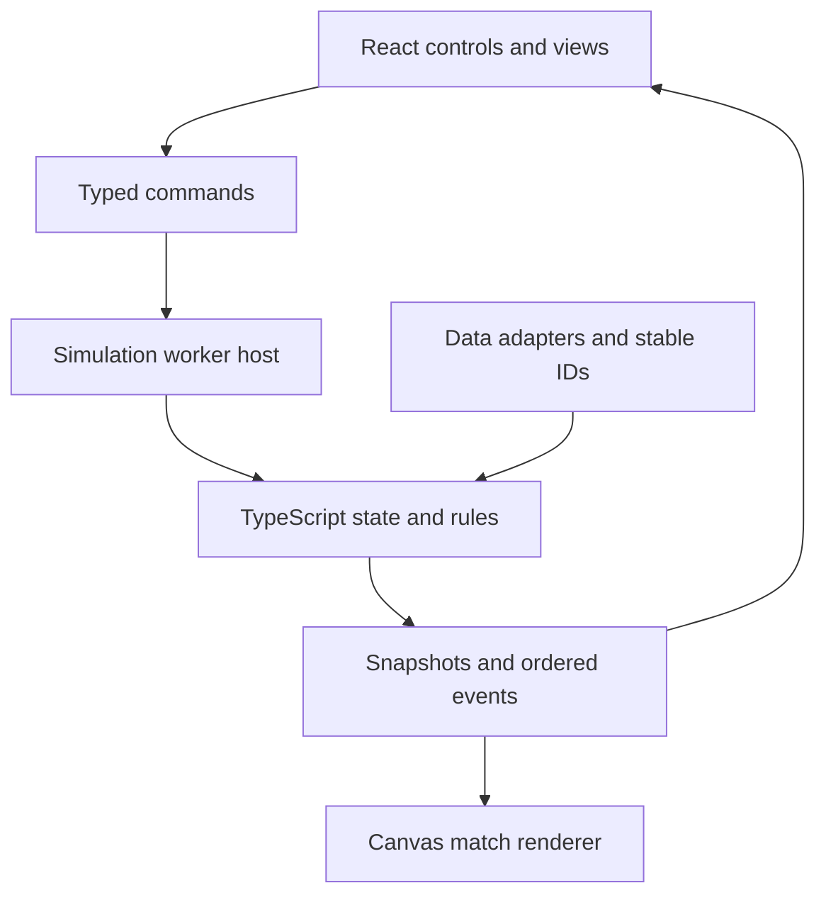

# TypeScript reconstruction and React presentation

The goal is a browser game whose chosen compatibility behavior is backed by evidence from the original executable. The code atlas maps the native program; implementation grows through verified subsystem contracts. Recovering every original class, function name or line of C++ is not assumed possible.

## Boundaries

| Component | Responsibility | Evidence / status |
| --- | --- | --- |
| Simulation core (TypeScript) | Match state, player calculations, rules, explicit RNG and ordered transitions | Four narrow reconstruction modules exist; full engine remains open |
| Event pipeline (TypeScript) | Select event variants at the original point in the random stream; emit stable event records | Layouts/mapping recovered; full pipeline not implemented |
| Data adapters | Convert locally acquired game data into stable IDs and typed records; preserve raw-width fields where needed | Layout fragments exist; complete database/save formats open |
| Worker host | Run simulation away from the UI thread; accept commands and publish snapshots/events | Proposed boundary; no worker implementation yet |
| React UI | Menus, squads, tactics controls, fixtures, tables and the match log | Proposed presentation layer; no React app in this PR |
| Match renderer | Display movement/ball snapshots using Canvas/WebGL if needed | Later visualization; original positions/actions must first be understood |
| Persistence adapters | Save/load versioned TypeScript state and RNG state | Proposed; original save compatibility is separate research |

The current `reconstruction/` directory holds the tested primitives. Move these into a simulation package only when a real host contract is introduced; avoid duplicating algorithms across research code and a UI. A future `packages/engine` and `apps/web` split can express these boundaries without changing today's evidence.

## Determinism belongs to the core

The core owns RNG state, event order and compatibility rules. React consumes immutable snapshots and sends explicit commands; rendering must not call `Math.random()` or advance match state. Use stable record IDs rather than native pointers at the UI boundary.

The original RNG is shared with commentary selection. Omitting a commentary draw can change a later gameplay draw. For original-compatible behavior, preserve those draws inside the simulation/event pipeline even when the UI hides or batches an event. Independent presentation RNG streams would be a deliberately different simulation mode, not an invisible refactor.

The penalty-preparation oracle sets the original sudden-death flag to suppress announcement calls. Its result therefore validates that calculation scope, not the complete live commentary/random-call history. This limitation must survive any later UI integration.

## Reconstruct behavior in layers

1. Inventory inferred functions and direct source-path anchors across the executable.
2. Establish a subsystem's inputs, outputs, state ownership and dependencies.
3. Inspect native widths/calling conventions and isolate a bounded path.
4. Capture original-instruction results under explicit fixtures.
5. Implement and check the TypeScript contract, then widen the path.
6. Add UI once a stable behavioral boundary exists.

Keep recovered facts, working interpretations and proposed architecture distinct. The inventory covers native code locations; it does not establish that all source, UI screens or competition rules have been rebuilt.
