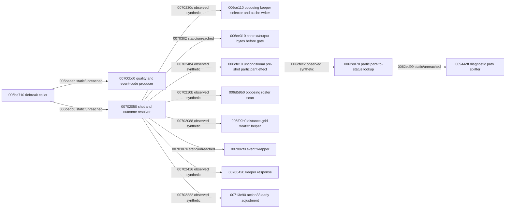

# Action 0x33 connected dependency frontier

Generated by `node scripts/render-action33-frontier.mjs --write` from `evidence/code-atlas/action33-frontier.json`.
Arrows marked “observed synthetic” were reached by original instructions on labelled synthetic state. “Static/unreached” arrows are assembly-mapped constraints or a stop-before boundary. This diagram does not establish a live match or a completed penalty attempt.

Original resolver prefix: 160 cases and 158784 original steps, ending before 007024b4.
Original effect continuation: 160 cases and 27390 additional steps, ending before 0062ed99.
TypeScript segment: 160 original-produced checkpoints from 007022fd to before 007024b4; first full-entry TypeScript gap 00702088 -> 006f09b0.

## Evidence state

- structural: partial caller, resolver and direct dependency map.
- local static: partial resolver; bounded local contracts for selected helpers.
- typescript: 007022fd..007024b4 semantic segment only.
- original instruction: 160 guarded synthetic resolver entries through pre-0062ed99.
- connected execution: same original machine and RNG through participant-effect diagnostic boundary; effect does not return.
- original game lifecycle: unobserved.
- outcome: unresolved.

## Open dependencies

| Dependency | First site | Required evidence | Assignment |
| --- | --- | --- | --- |
| typescript_prefix | 00702088 | compose original distance-grid float32 helper, then opponent scan and caller calculations before the supplied 007022fd checkpoint | R31-A in progress |
| early_guard | 00716125 | admit tactical bit-04-set opponent path through 007160f0 and its new callee | unassigned |
| diagnostic_path | 0062ed99 | admit original 00944cff path split and its transitive string/diagnostic effects | unassigned |
| normal_participant_state | 006cfeb8 | produce staff/attribute pointer and initialized lookup object through original setup before resolver entry; then admit 006cfe10 return and 006d0980 | R31-B in progress |
| event_stream | 0070387e | establish 007002f0/006d6f70 suppression, ordered draws and writes | unassigned |
| other_slots | 00703e24 | prove distance-branch reachability or admit 007103e0 transitive effects | unassigned |
| gate_context | 00703ff2 | establish 006ce310/004b0850 output and candidate state | unassigned |
| outcome | 00707dd6 | compare success/failure state, event and RNG through resolver return and caller remaining-count update | unassigned |
