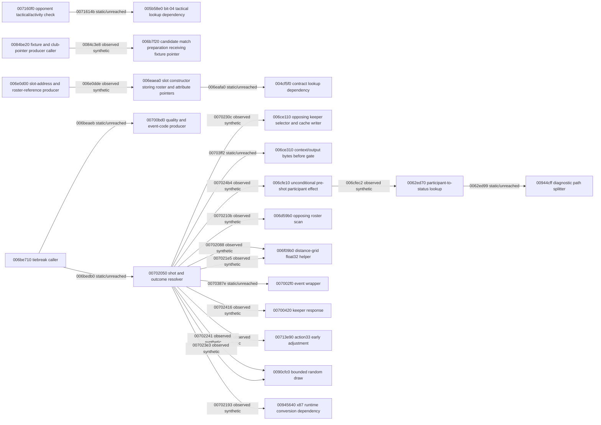

# Action 0x33 connected dependency frontier

Generated by `node scripts/render-action33-frontier.mjs --write` from `evidence/code-atlas/action33-frontier.json`.
Arrows marked “observed synthetic” were reached by original instructions on labelled synthetic state. “Static/unreached” arrows are assembly-mapped constraints or a stop-before boundary. This diagram does not establish a live match or a completed penalty attempt.

Original resolver prefix: 160 cases and 158784 original steps, ending before 007024b4.
Original effect continuation: 160 cases and 27390 additional steps, ending before 0062ed99.
TypeScript entry prefix: 160 original-entry cases from 00702050 to before 0070210b, plus 590 standalone grid-helper cases.
TypeScript guarded continuation: 220 original-entry cases, 204 clear and 16 bit-04-set, ending before 00702193 or 0071614b respectively.
TypeScript conversion continuation: 280 cases (232 clear, 16 bit-04-set and 32 separate rounding probes), with clear path ending before 00702222; hardware x87 exception/status equivalence is excluded.
Separate TypeScript interior segment: 160 original-produced checkpoints from 007022fd to before 007024b4; first full-entry TypeScript gap 00702222 -> 00713e90 (clear); 0071614b -> 005b58e0 (bit-04 set). These TypeScript paths are not joined.
Separate original lifecycle fixtures: 160 lookup returns, 80 placement frontiers, 80 nonnull status frontiers, 80 null diagnostics and 8 constructor OS frontiers; no enclosing live game caller.
Separate original slot fixtures: 80 initializer returns, 80 lookup returns, 80 placement frontiers and 80 nonnull status frontiers; first placement gap 006eaf8f.
Separate original fixture producers: 80 interior club-pointer producers and 80 interior caller bindings, followed by separate original entries ending before 006eafa0; no enclosing live game caller.

## Evidence state

- structural: partial caller, resolver and direct dependency map.
- local static: partial resolver; bounded local contracts for selected helpers.
- typescript: 00702050..pre-00702222 clear-path or pre-0071614b bit-04 guarded original-entry continuation and separate 007022fd..pre-007024b4 semantic segment; no joined TypeScript path.
- original instruction: 160 guarded synthetic resolver entries through pre-0062ed99.
- connected execution: same original machine and RNG through participant-effect diagnostic boundary; effect does not return.
- original game lifecycle: unobserved.
- outcome: unresolved.

## Open dependencies

| Dependency | First site | Required evidence | Assignment |
| --- | --- | --- | --- |
| typescript_prefix | 00702222 | admit 00713e90 and following caller effects with shared state toward the supplied 007022fd checkpoint | R34-A proposed |
| early_guard | 0071614b | admit 005b58e0 tactical lookup on bit-04-set path after 00ae23bc provenance and valid row lifetime | R34-A separate guard scope |
| diagnostic_path | 0062ed99 | admit original 00944cff path split and its transitive string/diagnostic effects | unassigned |
| normal_participant_state | 006eafa0 | initialize 00ae1050 contract receiver and execute 004cf5f0 with original-produced staff/home club, then finish placement and lookup-object lifecycle before resolver entry | R34-B proposed |
| event_stream | 0070387e | establish 007002f0/006d6f70 suppression, ordered draws and writes | unassigned |
| other_slots | 00703e24 | prove distance-branch reachability or admit 007103e0 transitive effects | unassigned |
| gate_context | 00703ff2 | establish 006ce310/004b0850 output and candidate state | unassigned |
| outcome | 00707dd6 | compare success/failure state, event and RNG through resolver return and caller remaining-count update | unassigned |
