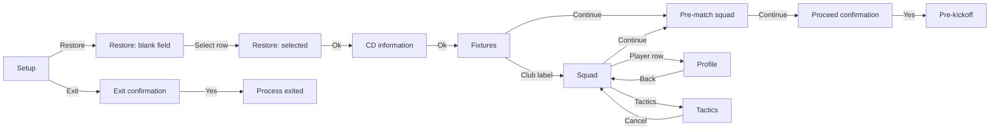

# R41-C3: application screen census and ongoing navigation map

The UI objective now covers the entire original application as navigation continues alongside engine work. [The machine-readable census](../evidence/ui-screen-census-41.json) is the first bounded frontier, based on original captures 01–16 and A4 action-index entries 001–011. Later A4 match tabs and post-match navigation belong to the next capture batch. The total number of discoverable application states remains unknown; these counts are not a completion percentage.

| Machine-checked denominator set | Count | Meaning |
| --- | ---: | --- |
| Screenshot-confirmed screen/state IDs | 17 | At least one retained, directly inspected image. |
| Operator-route-only state IDs | 5 | Reported CD request, Game Options, restart confirmation, restart save prompt and save dialog; no retained layout image in this cutoff. |
| Terminal state IDs | 1 | Operator confirmed process exit; this is not a screen. |
| Discovered uncaptured control-route IDs | 60 | Visible labels/action affordances with unresolved destinations or effects; they are not 60 proven additional screens. Disabled Back remains an appearance, not a discovered route. |
| Unknown/unbounded application sections | 12 | Internal tab/modal/error/state populations have no finite denominator yet. |
| Total application screen/state denominator | Unknown | Whole UI remains an ongoing target. |

Coverage flags are independent: **screenshot**, **layout**, **observed transition**, **engine binding**. This batch contains 27 screenshot files, 15 states with approximate mapped geometry, and 21 catalogue states touched by a recorded action edge, including operator-only states and the exit terminal. None has an established engine binding. Running/half-time image sequences do not count as tested actions; native initialization error dialogs are seen but do not yet have mapped game-client geometry. A screenshot is never promoted to behavior validation. The JSON carries each flag, its evidence and exact set membership; the checker derives and verifies every denominator.

The observed screenshot states are Setup Game; restore with blank File field; restore with selected file; CD information; language/configuration error dialogs; evening fixtures; ordinary/pre-match squad; player profile; tactics overview; proceed confirmation; pre-kickoff/running/half-time/full-time match; and Exit confirmation. The historical `ui41.squad.returned` ID aliases ordinary squad selection rather than creating a duplicate screen for a repeated capture. Blank file-list slots and grey-looking Back/Next controls are recorded as appearances; an entirely empty directory or a disabled action contract is not inferred. A4 explicitly reports fixture Back disabled; confirmation No and several Cancel routes remain unexercised.

The adjacency list in the JSON is generated only from **operator-observed action** edges and checked against those edges. Tactics returns via observed Cancel; Back on that state is unobserved. An observed Back declaration requires a matching Back control and action edge. The checker pins the full reviewed state declarations, including Back status and target, the complete 60-control frontier, 12 unknown-section declarations, the denominator's limited scope, and the top-level cutoff, completion, coverage and capture protocol claims for this batch. It also pins capture contexts, screenshot/report metadata, layout geometry, full transition declarations, historical aliases and capture requests; the next reviewed batch will explicitly update these pins. Every counted screenshot must belong to a mapped state, and a screenshot hash can belong to only one state. It binds each edge to its reviewed source state, destination state and confidence, and each action edge to the operator receipt's declared action and launch context; any cited screenshot must belong to an endpoint state and matching context. Screenshot sequences require an image from each endpoint. The private A4 receipt is still an opaque provenance declaration, not cryptographic proof of its operator actions. The earlier external-input load gap remains a separate relation. The principal mapped routes are:



The successful A4 media-information route does not retroactively resolve the original load's externally interrupted CD-request transition. Exit No is labelled but was not exercised. The operator-only restart route is separately recorded: result → Game Options → Restart → save-before-restart; Cancel returned to result, while saving separately caused a new native process. No same-process reload is established.

Identity is scoped per capture: matched A/B pre-run configuration; later B capture-time configuration unverified; restarted child known to have only 774 of 784 expected files; A4 failed launch with uncontrolled working directory; and A4 successful fresh launch after exact revalidation with the correct working directory. Screens are not pooled under one current-configuration claim. The two native error dialogs and subsequent successful launch are observations of different launch contexts, not proof of an error cause or recovery contract. JPEG encoding and outer dimensions are retained even for files named `.png`; the small native dialogs are not treated as 800 × 600 game windows.

Approximate geometry, field labels/order, controls, back status and asset bindings are explicit per state. Original typography, palettes and native handlers remain unknown. The installed resource manifest supplies candidate asset IDs; this census does not guess background-to-screen bindings from visual resemblance. Empty/disabled/modal variants, filter/sort effects and command side effects remain capture targets.

The highest-priority requests sent to sole operator R41-A4, after paired-probe cleanup, are read-only Finances & Info/Transfers tabs, profile subtabs, competition/fixture/table routes, then representative search/nation/training families. Each batch must record identity, entry/prerequisite/action, back **observed or unexercised**, active tab/modal, image hash/encoding/dimensions, and time/state effects **observed or unknown**. Do not manufacture empty states or make transactions merely for coverage. Newly exposed labels expand the uncaptured frontier and unknown sections; the census does not assume the starting menu exhausts the app.

Run the standalone consistency/privacy checker normally and under optimized Python:

```text
python scripts/check_ui_census_41.py
python -O scripts/check_ui_census_41.py
python scripts/check_ui_census_41.py --private-root PRIVATE_CAPTURE_ROOT --private-aliases PRIVATE_ALIAS_JSON --private-snapshot PRIVATE_VIEWER_SNAPSHOT
```

The checker seals this complete public UI report by a reviewed UTF-8 digest, so its coverage totals and prose cannot drift from the census without an intentional pin update. It also reads the public operator report and verifies its complete UTF-8 file digest after CRLF-to-LF normalization only, matching Git's retained LF blob. LF and CRLF checkouts must produce the same digest; altered source content and an altered expected digest are rejected. Private operator-note/index receipts explicitly retain raw-byte hashes and are labelled as not loaded by the public check.

The optional check reads private files only to compare image hashes/JPEG dimensions and reject copied display strings from the squad and profile snapshot in the public catalogue/report. It scans club/date labels, all roster display fields including Picked and Info, profile text and contextual attribute label/value pairs; generic role, position, Info and morale text and short values are checked with their field label because isolated values are ambiguous. Contextual checks cover prose and Markdown table forms, including balanced emphasis or code wrappers around exact labels and values, nested value wrappers, inline formatting within exact multiword values and Markdown links, image-alt and reference text, HTML tags/entities, punctuation escapes and rendered Markdown whitespace, after decoding JSON escapes, while JSON objects and JSON fragments inside their string fields are parsed from original text to preserve quoted content and braces in other fields. JSON label/value pairs are checked regardless of key order or intervening properties, with finite integral numeric forms compared as the same displayed integer. Census JSON loading rejects duplicate keys before validation or privacy scanning. Path and payload marker matching is case-insensitive; captured display matching is Unicode NFC-normalized and case-insensitive, including case-folded structured label/value pairs and recognized JSON keys; colliding key variants fail closed. It prints no private values. Eighty-six public negative probes reject broken references, unrelated action/context receipts, retargeted or confidence-promoted edges with regenerated derived fields, cloned visual states, invented control routes or unknown sections, unowned or borrowed screenshots with recalculated denominators, altered screenshot hashes/dimensions, executable identity or layout geometry, a forward Continue action mislabeled as Back, false top-level completion/coverage or whole-app denominator-scope claims and added unreviewed root or denominator fields, duplicate JSON keys hiding a private path, case variants of private roots and payload markers, screenshot sequences missing endpoint images, unevidenced routes or nonvisual states, invented whole-app denominators, geometry overflow, unsupported engine promotion, escaped, unrelated or downgraded operator reports, changed report content/digests and coverage totals, captured display payloads, absolute POSIX, Windows UNC and root-relative Windows paths, including a single-component filenames and directory names that are short, Unicode or contain spaces, including nested Markdown code, emphasis and strike wrappers (including after newline or tab) and private relative roots in the census or public report. Nine public path near-miss probes allow ordinary repository-relative Windows paths, including hyphen, plus, at-sign, backtick, underscore and tilde prefixes and a nested relative-path span, and escaped punctuation. Forty-nine private leak probes cover club/date labels, biography, Picked/Info, role and attribute value pairs in these formats, including escaped, case-varied and canonically equivalent names, sentence punctuation, reverse JSON order, case-varied and colliding JSON keys, quoted/braced intervening values, nested JSON strings and integer, decimal-integral and exponent numeric forms; three synthetic JSON quote-escape, Unicode-equivalent structured-pair and Markdown-punctuation escape probes and four near-miss probes check decoding, generic morale, literal expressions and complete attribute values, including a distinct fractional decimal. Normal and optimized Python checks passed with identical summaries, including all 27 private image hashes/dimensions and captured-token rejection. The Node 24 full repository check and whitespace check passed. No browser, game, process or native database access is used. Raw screenshots, private action paths and captured values stay outside Git. Private cutoff/alias annotations are local; source capture preservation remains with R41-A4, without an off-host durability claim here. The prior asset inventory and React viewer are preserved; their narrower scope follows.

## R41-C2: bounded journey and reference viewer

The actual observed route is **restore → evening fixtures → squad → player profile → Back → tactics → Cancel → squad → match confirmation → pre-kickoff → running match → result**. R41-A alone operated the disposable GDI game and recorded the actions. R41-C2 inspected the retained screenshots offline and built a bounded squad/profile reference viewer from their visible values. This establishes UI navigation/display evidence, not reconstructed game execution.

## Identity and source evidence

The running GDI executable is SHA-256 `0e50572c292bdfb9de8b3e087dd29043a13bcd0985ed198c9011e5a0f694388b`, distinct from the pinned research executable `0c78e7da6d0bcb4603fa179449bbe6d1b6b5e1c627a22c445d14d489bd9bff86`. The duplicated save is SHA-256 `8698569fbd83d9952a9832a95aee17a943c32f18e29621e9396ed228107abbd3`. R41-A's configuration-set digest is `fd4d4fefe5890bc26f7e67722de4efe5738cb76d53035d8953b6bc02cc3a897a`: installed files plus the VirtualStore language/configuration overlay, with the copied save-directory setting changed. That setting's file hash differs from the original installation inventory. The installation is modded; the [asset report](asset-inventory-41.md) separately identifies its update splash and resources.

[The capture receipt](../evidence/ui-view-41-captures.json) records source screenshot hashes and dimensions. Files retain their original `.png` names but contain **JPEG** bytes. Captures 01/02 are 802 × 653; 03–11 are 802 × 627. The game client is approximately 800 × 600, beginning at image `(1, 27)`; extra outer whitespace is present in 01/02. Exact JPEG colors are not authenticated palette values.

Raw files are private in R41-A's ignored capture directory; the public receipt contains hashes and sanitized evidence IDs only. The personal manager label is excluded from the view model. A CD prompt occurred after restore selection, followed by intervening external input; the next retained screen is loaded fixtures. Neither this catalogue nor the viewer attributes dismissal of that prompt to R41-A's click.

## Screen/action catalogue

Capture IDs below abbreviate the `r41-ui-` prefix. Navigation actions are R41-A's recorded observations; appearance and fields were also inspected directly in the named files. A still image alone does not prove an action effect.

| Stable screen/state ID | Capture | Observed entry, visible fields and actions | Boundary and unknowns |
| --- | --- | --- | --- |
| `ui41.load.menu` | `01-menu` | Version 3.9.68; Setup Game grid includes Restore Saved Game, Start New Game, Quick Start Game and other options. Restore opened the file picker. | Other menu actions, keyboard shortcuts and disabled-state behavior untested. |
| `ui41.load.restore` | `02-restore` | Restore Saved Game / Select File; one duplicated save; file field, Cancel, Info, Ok. Selecting save preceded the CD prompt and fixtures. | CD dismissal has intervening external input; full load/error/persistence contract unknown. |
| `ui41.fixture.evening` | `03-fixtures` | Competition heading, Evening Fixtures; date/phase, group labels, pairings and position badges. Clicking the managed club label opened squad. | No evidence that this is a direct route from every fixture view. Competition control and fixture sorting untested. |
| `ui41.squad.selection` | `04-squad` | Managed club; active Squad tab; Selection Info; 13 visible roster rows. Clicking the second visible player opened profile. | The scrollable roster is larger than its visible slice; no sorting/filtering/selection mutation admitted. |
| `ui41.player.profile` | `05-player` | Same selected player name, shirt prefix, club; biography, role, 31 integer attributes in three columns, foot/form/morale/condition and a statistics table. Bottom Back returned squad. | Identity link is observed navigation, not a recovered native player ID. Other tabs/action menu, next player and statistics controls untested. |
| `ui41.tactics.overview` | `06-tactics` | Squad bottom Tactics opened overview; tactic label; Overview/With Ball/Without Ball; player list, conditions and shirt-number pitch nodes; Cancel returned squad. | No intentional formation or selection edits. Handlers, persistence and tactical engine effects unknown. |
| `ui41.squad.returned` | `07-squad-after-tactics` | Repeated visible roster slice and ordering; private values retained in source evidence. | Captures are sequential and not atomic. No condition-change or navigation-caused update is established. |
| `ui41.match.confirm` | `08-proceed-modal` | Continue twice from squad, with an uncaptured pre-match selection step, led to “Proceed to the match ?” with No/Yes. Yes opened pre-kickoff. | First intermediate state's exact layout and No/back behavior unobserved. Continue can invoke game logic; viewer cannot issue it. |
| `ui41.match.prekickoff` | `09-match-before-kickoff-A` | Initial clock/score, Kick Off, Kick Off Match control; referee/weather fields; overview/statistics/zones/report tabs. | Native match initialization and supported headless commands are not established by this screen. |
| `ui41.match.running` | `10-match-running-A` | Second Half; clock/score/event fields and Pause Match control. Commentary and scorer list contain different event references. | Display fields are separate observations. Commentary/score timing relationship and cause are unresolved; no outcome inferred from commentary. |
| `ui41.result.fulltime` | `11-result-A` | Full Time; clock, score, scorer, attendance, referee/weather fields; Continue Game available. Captured values remain private. | Later result commit, continue and persistence unobserved at this cutoff; restart route is recorded separately above. This is not a TypeScript outcome or pinned-runtime equivalence. |

## Components, formatting and layout

At the observed resolution, the original has an approximately 90-pixel left navigation rail, a wide heading band, horizontal tabs and grey bottom navigation. Background photographs occupy the main pane; this integration uses CSS color panels because original assets remain private. Active tabs have yellow outlines; dark blue/purple navigation, yellow values, cyan position/rating text and orange condition text recur. Arial-like body text and larger bold headings are visible, but exact font metrics remain unresolved by the opaque FNT files. React's browser Arial and colors are approximations, not recovered typography/palette equivalence.

The squad column order is **Pkd, Inf, Name, Position, Form, Morale, Cond., Apps, Av R, Value**. Blank picked/info cells remain blank; display strings preserve punctuation, percent signs, decimal places, currency suffixes and parenthesized substitute counts. No new sort order, numeric conversion, rating ceiling, attribute units or currency calculation is inferred. The View, Clear Squad and Filter controls are visible but untested. Column-header sorting and keyboard navigation in the original are unknown.

Profile attributes retain their observed three-column order. Seven attributes occupy the third column, followed by Preferred Foot, Form, Morale and Condition. Biography and Goalkeeper role are displayed verbatim in the private snapshot. The native statistics grid is visible but intentionally outside this bounded view model, with its omission labelled in React. Player details are historical save/mod data; they are not current real-world facts.

Reusable elements now have bounded specifications: heading/active tab, roster table with one supported profile link, three attribute columns, status text, captured-source label and Back navigation. Tactics pitch editing, fixture actions, commentary stepping, dialogs and game-state updates remain unavailable in the app. All underlying native UI field offsets, handlers and engine dependencies remain unestablished here; the prior static match-screen contracts are separate evidence.

## What runs in React

[The app](../apps/reference-viewer-41/README.md) loads a local JSON transcription and displays **13 captured visible roster rows → one captured player profile with 31 attributes → Back**. Stable IDs are local to the captured slice (`row01`–`row13`), not native record IDs. The profile references its roster row and both screens retain separate capture IDs, GDI/save/configuration identities and resolution. A validator rejects orphan profiles, duplicate IDs, missing provenance, unsupported fields/commands, oversized data and other resolutions.

Only captured values are transcribed. Public Git includes the typed schema and a clearly labelled synthetic example; the actual view model is private in the worker's ignored capture directory, identified by the [verification receipt](../evidence/ui-view-41-verification.json). The browser reads that file locally without upload, persistence or external resources. It displays CAPTURED · READ ONLY for actual data and SYNTHETIC EXAMPLE for the public fixture. File loading is a viewer action, not original-game save loading. Original screenshots, background images, font data and manager names are absent from the app/build.

Profile navigation only changes React's visible screen. No simulation rule, RNG call, native game command or time advancement exists in the renderer. Controls for continue, tactics, transfers, other profiles and unsupported tabs are disabled/unavailable. Back returns the same captured roster values and order. The application cannot guarantee original-game navigation has no side effects; it is deliberately a captured-data viewer.

## Validation and next boundary

TypeScript compilation and production build passed with Node 24.19.0. Snapshot checks pass with eight meaningful malformed-contract rejections. Browser checks on synthetic and corrected private captured data passed at **800 × 600**: roster order/display fields, all 13 rows fitting, supported profile navigation, Back preservation, disabled game commands, malformed-file rejection and zero external requests. Both refreshed captured renders were visually inspected for layout. The full repository `npm run check` passed; the renderer code is unchanged by the transcription correction below.

Independent source review found the eleventh visible row's Form had been transcribed incorrectly. Both retained source squad captures support the correction; the source values, corrected private snapshot and reproduction script remain private. After the user confirmed dismissal of the security dialog, the corrected-input browser gate passed and refreshed private PNGs were generated. The verification receipt pins their current input/render hashes and retains superseded hashes as history. Pixel comparison confines the squad image change to the corrected Form cell; the profile image is unchanged. Parser, production build and privacy checks passed after correction. The earlier private static HTML remains supporting evidence. No security dialog or game UI was operated by this worker; the bounded browser/server exited after testing. Generated captured outputs remain ignored/private; `git diff --check` passed.

This is a connected display/navigation result, not live game-state binding. Next work requires a native roster/profile producer or an evidenced engine command contract before connecting any state-changing action. A separate private ZIP preserves the corrected input, renders and reproduction evidence: eight payload files plus a manifest were independently restored and all nine entries rehashed. Its digest and restore receipt are recorded in the verification JSON. This establishes a verified local archive; off-host durability is unverified. Raw source captures and their configuration remain owned and preserved separately by R41-A.
