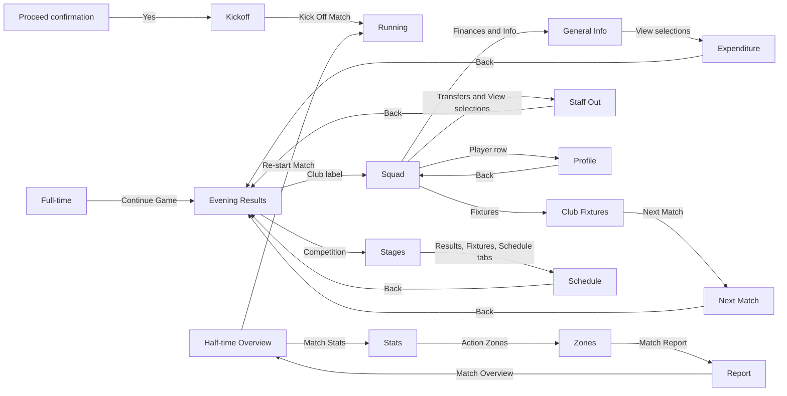

# R41-C4: second bounded application screen census

The UI objective covers the entire original application as navigation continues alongside engine work. [The machine-readable census](../evidence/ui-screen-census-41.json) now retains original captures 01–16 and A4 action-index entries 001–078. This second increment admits **67 already retained images, entries 012–078**, inspected offline; it adds no game inputs. The total application state population remains unknown. These counts describe the enumerated frontier, not completion percentages.

| Machine-checked denominator set | Count | Meaning |
| --- | ---: | --- |
| Screenshot-confirmed screen/state IDs | 50 | Directly inspected image for each canonical state; repeated captures and selected-context variants are separate evidence. |
| Operator-route-only state IDs | 5 | CD request, Game Options, restart confirmation, restart save prompt and save dialog; no retained layout image. |
| Terminal state IDs | 1 | Confirmed process exit, not a screen. |
| Discovered uncaptured control-route IDs | 111 | 52 preserved prior routes plus 38 newly enumerated controls and 21 unexercised bottom-Back sources. Destinations/effects remain unknown. |
| Unknown/unbounded sections | 12 | Partial screens do not exhaust finance, transfer, competition or other application families. |
| Total application state denominator | Unknown | Whole UI remains an ongoing target. |

There are **94 screenshot files, 33 approximate layout templates, 48 states with mapped geometry and 56 catalogue states touched by recorded action edges**. The latter includes operator-only and terminal states and means at least one action at an endpoint, not every control tested. There are **81 canonical observed-action edges, five screenshot-sequence relations and one unresolved load gap**. None establishes a UI engine binding. Approximate layouts share regions where appropriate: transfer lists, income/expenditure breakdowns and competition results and fixtures; active fields, absent controls and empty appearances remain per-state declarations.

## Exact scope and evidence

The second increment adds 33 state IDs, 24 layout IDs, 58 action edges and one running-to-half-time screenshot sequence. The JSON's `batch_delta` lists every added image/state/layout/transition/route ID, all eight closed route IDs and all 52 preserved route IDs. The 28 prior edge endpoint/status tuples remain unchanged. Existing Yes-to-match, squad-to-profile and Profile-Back edges receive A4 corroboration; older screenshot sequences remain sequences. Adjacency is generated only from observed-action edges.

| Added family | New canonical states | A4 image evidence | Observed action and remaining limit |
| --- | ---: | --- | --- |
| Half-time tabs | 3 | 015–018 | Overview → Match Stats → Action Zones → Match Report → Overview; source phase is half-time. Pre-kickoff tab routes remain open. |
| Evening Results entry | 1 | 022 and repeated returns | Full-time Continue Game → Evening Results; club and competition entry actions observed. Distinct from earlier Evening Fixtures and competition Results tab. |
| Finances & Info | 6 | 024–032 | Five content modes and one View popup; Expenditure Back → Evening Results only. |
| Transfers | 8 | 035–047 | Seven content modes and one View popup; Staff Out Back → Evening Results only. |
| Player details/history | 8 | 051–067 | Injuries & Bans, Contract, Transfer; four History modes and one popup. Profile tab returns observed from main tabs and history Bans. |
| Club Fixtures/Next Match | 2 | 069–071 | Squad → Fixtures → Next Match → bottom Back → Evening Results. Direct Squad → Next Match remains unexercised. |
| Competition | 5 | 072–078 | Evening Results → Stages; Group popup → another group, Results → Fixtures → Schedule → Back. |

Evidence IDs in the JSON use the full `r41-a4-ui-` prefix. Groups A/B are two data selections of one Stages screen; the eight labelled options are a finite parameter family. Four finance, six transfer, three history and one group selected-context popup captures form **14 popup variants**, not 14 additional screens. Reopening the Group menu with Group B selected is a variant gap. Natural primary empty lists are retained in Future Transfers, Loans In, Staff In, Staff Out and historical Bans. Numeric zeros and blank fields do not imply a wholly empty screen. Current-season/date forward or backward controls, competition Print and entry Back/Next have dim appearances; disabled handlers were not tested.

## Observed routes and Back gaps



The grouped View/tab arrows above summarize consecutive menu actions; the JSON contains each individual edge. Natural match progression is deliberately absent from this action-only graph. Match tabs were captured after probe cleanup at half-time; the ordinary kickoff had a bounded engine probe attached beforehand. This UI census does not turn that runtime observation into a field or command binding.

Bottom Back is observed from **Expenditure, Staff Out, Next Match and Competition Schedule to Evening Results**, and from **Profile to Squad**. It is unexercised from four other finance modes, six other transfer modes, three other main player tabs, all four history modes, Club Fixtures and three other competition modes: **21 explicit source-specific gaps**. Clicking Profile is a tab return, not bottom Back. History was first entered from Transfer, not Profile. Do not infer Back behavior from a neighboring mode. Popup Escape/outside dismissal and preservation of selections remain unknown.

Eight prior routes close under their exact source conditions: Squad → Finances & Info/Transfers/Fixtures; Profile → Injuries & Bans/Contract/Transfer; half-time Re-start Match; full-time Continue Game. Direct Profile → History, Squad → Next Match, earlier Evening Fixtures → Competition and pre-kickoff match-tab routes remain open. The three earlier Evening Fixtures-source Find, Nations & Clubs and manager routes also remain open. A6 starts at distinct Evening Results and requests three separately enumerated Results-source routes; its menu exploration cannot close the earlier source gaps. Each request declares its entry and exact route-source state IDs, checked against its route references. The 38 additional visible-control routes include menus, scrolling, season/date navigation and retained subview controls. The Group-menu selected-B context is a variant gap; the dim competition Print label and red News indicator hit target are held outside the actionable-route denominator. Fixture Cancel is a visible unexercised command, not authorization to cancel anything.

## Identity, privacy and verification

Each retained image keeps its executable/configuration/origin-save context. Original GDI A/B, later unverified B, partial restart, failed launch and restored A4 contexts remain separate. A4 uses the existing restored context: exact GDI executable, original duplicated input save, revalidated 784-file configuration and explicit launch working directory. The post-batch receipt rechecks disk inputs. An origin-save hash does not identify the post-match in-memory state. During post-match navigation the visible rail date/phase remained unchanged; internal cache/RNG/other state effects are unknown. Future dates inside fixture content do not show world-time advancement. Index timestamps are retention times following observation, not exact screenshot/input times.

The retained full action index is an opaque private receipt, SHA-256 `22b7a469643ca7860043f76044e85eba002e61d972d0133f11f35c7dd2fb4e48`; its declarations are operator evidence, not cryptographic proof of actions. All 67 new images are JPEG, 802 × 627 outer pixels, with an approximately 800 × 600 game client at `(1, 27)`. Earlier native error dialogs retain their smaller actual dimensions. Raw screenshots, installed assets, executables, saves, bulk game databases and local capture paths remain outside Git. Individual player names and short displayed values are permitted; the checker does not classify them as private bytes. Source evidence is preserved in the operator's restore-tested local archive; no off-host durability claim is made here. Asset-to-screen binding, exact typography/palette, keyboard behavior and native handlers remain unknown.

Python 3.12+ is required for the standalone checker; the root check requires Node 24+ and Python 3.12+ as documented in the repository README. The root runner retains its explicit Python executable prerequisite.

The checker deliberately extends the reviewed batch pins for every state declaration, full frontier, contexts/evidence/layouts/transitions/requests, aliases and top-level scope. It validates the explicit batch delta, prior topology preservation, selected-context variants, unknown Back targets, endpoint/context evidence and action receipts. Both the complete public UI report and the tracked operator report are checked after CRLF-to-LF normalization; private receipts retain raw-byte hashes. The merged path/payload guard, including rendered Markdown/HTML and Unicode-boundary checks, scans the census and both reports. Normal and optimized Python execute the same consistency/privacy checks; the root Node 24 check invokes public mode. Optional private mode compares all 94 image hashes/JPEG dimensions and the two new raw-byte receipt hashes. It has no player-string scanner or snapshot option. These checks do not replay original navigation.

```text
python scripts/check_ui_census_41.py
python -O scripts/check_ui_census_41.py
python scripts/check_ui_census_41.py --private-root PRIVATE_CAPTURE_ROOT --private-aliases PRIVATE_ALIAS_JSON
```

Next requests remain with sole game operator R41-A: safe manager/news hit testing, Training/default/search/nation menus, competition statistical/history views and View/Stage menus, retained completed-match views, exact direct-source gaps and the 21 Back routes. Capture actual prerequisites/actions/returns and any state change; no Clear Squad, fixture cancellation, offer/contract/tactics edits or world-time advancement merely for coverage. The reference viewer below remains unchanged and has no game commands.

## R41-C2: bounded journey and reference viewer (historical narrower cutoff)

The following catalogue and untested statements describe the earlier C2 viewer cutoff. C4 observations above supersede its navigation gaps only where exact source actions are retained.

The actual observed route is **restore → evening fixtures → squad → player profile → Back → tactics → Cancel → squad → match confirmation → pre-kickoff → running match → result**. R41-A alone operated the disposable GDI game and recorded the actions. R41-C2 inspected the retained screenshots offline and built a bounded squad/profile reference viewer from their visible values. This establishes UI navigation/display evidence, not reconstructed game execution.

## Identity and source evidence

The running GDI executable is SHA-256 `0e50572c292bdfb9de8b3e087dd29043a13bcd0985ed198c9011e5a0f694388b`, distinct from the pinned research executable `0c78e7da6d0bcb4603fa179449bbe6d1b6b5e1c627a22c445d14d489bd9bff86`. The duplicated save is SHA-256 `8698569fbd83d9952a9832a95aee17a943c32f18e29621e9396ed228107abbd3`. R41-A's configuration-set digest is `fd4d4fefe5890bc26f7e67722de4efe5738cb76d53035d8953b6bc02cc3a897a`: installed files plus the VirtualStore language/configuration overlay, with the copied save-directory setting changed. That setting's file hash differs from the original installation inventory. The installation is modded; the [asset report](asset-inventory-41.md) separately identifies its update splash and resources.

[The capture receipt](../evidence/ui-view-41-captures.json) records source screenshot hashes and dimensions. Files retain their original `.png` names but contain **JPEG** bytes. Captures 01/02 are 802 × 653; 03–11 are 802 × 627. The game client is approximately 800 × 600, beginning at image `(1, 27)`; extra outer whitespace is present in 01/02. Exact JPEG colors are not authenticated palette values.

Raw files are private in R41-A's ignored capture directory; the public receipt contains hashes and sanitized evidence IDs only. The personal manager label is excluded from the view model. A CD prompt occurred after restore selection, followed by intervening external input; the next retained screen is loaded fixtures. Neither this catalogue nor the viewer attributes dismissal of that prompt to R41-A's click.

## Screen/action catalogue

Capture IDs below abbreviate the `r41-ui-` prefix. Navigation actions are R41-A's recorded observations; appearance and fields were also inspected directly in the named files. A still image alone does not prove an action effect.

| Stable screen/state ID | Capture | Observed entry, visible fields and actions | Boundary and unknowns |
| --- | --- | --- | --- |
| `ui41.load.menu` | `01-menu` | Version 3.9.68; Setup Game grid includes Restore Saved Game, Start New Game, Quick Start Game and other options. Restore opened the file picker. | Other menu actions, keyboard shortcuts and disabled-state behavior untested. |
| `ui41.load.restore` | `02-restore` | Restore Saved Game / Select File; one duplicated save; file field, Cancel, Info, Ok. Selecting save preceded the CD prompt and fixtures. | CD dismissal has intervening external input; full load/error/persistence contract unknown. |
| `ui41.fixture.evening` | `03-fixtures` | Competition heading, Evening Fixtures; date/phase, group labels, pairings and position badges. Clicking the managed club label opened squad. | No evidence that this is a direct route from every fixture view. Competition control and fixture sorting untested. |
| `ui41.squad.selection` | `04-squad` | Managed club; active Squad tab; Selection Info; 13 visible roster rows. Clicking the second visible player opened profile. | The scrollable roster is larger than its visible slice; no sorting/filtering/selection mutation admitted. |
| `ui41.player.profile` | `05-player` | Same selected player name, shirt prefix, club; biography, role, 31 integer attributes in three columns, foot/form/morale/condition and a statistics table. Bottom Back returned squad. | Identity link is observed navigation, not a recovered native player ID. Other tabs/action menu, next player and statistics controls untested. |
| `ui41.tactics.overview` | `06-tactics` | Squad bottom Tactics opened overview; tactic label; Overview/With Ball/Without Ball; player list, conditions and shirt-number pitch nodes; Cancel returned squad. | No intentional formation or selection edits. Handlers, persistence and tactical engine effects unknown. |
| `ui41.squad.returned` | `07-squad-after-tactics` | Repeated visible roster slice and ordering; private values retained in source evidence. | Captures are sequential and not atomic. No condition-change or navigation-caused update is established. |
| `ui41.match.confirm` | `08-proceed-modal` | Continue twice from squad, with an uncaptured pre-match selection step, led to “Proceed to the match ?” with No/Yes. Yes opened pre-kickoff. | First intermediate state's exact layout and No/back behavior unobserved. Continue can invoke game logic; viewer cannot issue it. |
| `ui41.match.prekickoff` | `09-match-before-kickoff-A` | Initial clock/score, Kick Off, Kick Off Match control; referee/weather fields; overview/statistics/zones/report tabs. | Native match initialization and supported headless commands are not established by this screen. |
| `ui41.match.running` | `10-match-running-A` | Second Half; clock/score/event fields and Pause Match control. Commentary and scorer list contain different event references. | Display fields are separate observations. Commentary/score timing relationship and cause are unresolved; no outcome inferred from commentary. |
| `ui41.result.fulltime` | `11-result-A` | Full Time; clock, score, scorer, attendance, referee/weather fields; Continue Game available. Captured values remain private. | Later result commit, continue and persistence unobserved at this cutoff; restart route is recorded separately above. This is not a TypeScript outcome or pinned-runtime equivalence. |

## Components, formatting and layout

At the observed resolution, the original has an approximately 90-pixel left navigation rail, a wide heading band, horizontal tabs and grey bottom navigation. Background photographs occupy the main pane; this integration uses CSS color panels because original assets remain private. Active tabs have yellow outlines; dark blue/purple navigation, yellow values, cyan position/rating text and orange condition text recur. Arial-like body text and larger bold headings are visible, but exact font metrics remain unresolved by the opaque FNT files. React's browser Arial and colors are approximations, not recovered typography/palette equivalence.

The squad column order is **Pkd, Inf, Name, Position, Form, Morale, Cond., Apps, Av R, Value**. Blank picked/info cells remain blank; display strings preserve punctuation, percent signs, decimal places, currency suffixes and parenthesized substitute counts. No new sort order, numeric conversion, rating ceiling, attribute units or currency calculation is inferred. The View, Clear Squad and Filter controls are visible but untested. Column-header sorting and keyboard navigation in the original are unknown.

Profile attributes retain their observed three-column order. Seven attributes occupy the third column, followed by Preferred Foot, Form, Morale and Condition. Biography and Goalkeeper role are displayed verbatim in the private snapshot. The native statistics grid is visible but intentionally outside this bounded view model, with its omission labelled in React. Player details are historical save/mod data; they are not current real-world facts.

Reusable elements now have bounded specifications: heading/active tab, roster table with one supported profile link, three attribute columns, status text, captured-source label and Back navigation. Tactics pitch editing, fixture actions, commentary stepping, dialogs and game-state updates remain unavailable in the app. All underlying native UI field offsets, handlers and engine dependencies remain unestablished here; the prior static match-screen contracts are separate evidence.

## What runs in React

[The app](../apps/reference-viewer-41/README.md) loads a local JSON transcription and displays **13 captured visible roster rows → one captured player profile with 31 attributes → Back**. Stable IDs are local to the captured slice (`row01`–`row13`), not native record IDs. The profile references its roster row and both screens retain separate capture IDs, GDI/save/configuration identities and resolution. A validator rejects orphan profiles, duplicate IDs, missing provenance, unsupported fields/commands, oversized data and other resolutions.

Only captured values are transcribed. Public Git includes the typed schema and a clearly labelled synthetic example; the actual view model is private in the worker's ignored capture directory, identified by the [verification receipt](../evidence/ui-view-41-verification.json). The browser reads that file locally without upload, persistence or external resources. It displays CAPTURED · READ ONLY for actual data and SYNTHETIC EXAMPLE for the public fixture. File loading is a viewer action, not original-game save loading. Original screenshots, background images, font data and manager names are absent from the app/build.

Profile navigation only changes React's visible screen. No simulation rule, RNG call, native game command or time advancement exists in the renderer. Controls for continue, tactics, transfers, other profiles and unsupported tabs are disabled/unavailable. Back returns the same captured roster values and order. The application cannot guarantee original-game navigation has no side effects; it is deliberately a captured-data viewer.

## Validation and next boundary

TypeScript compilation and production build passed with Node 24.19.0. Snapshot checks pass with eight meaningful malformed-contract rejections. Browser checks on synthetic and corrected private captured data passed at **800 × 600**: roster order/display fields, all 13 rows fitting, supported profile navigation, Back preservation, disabled game commands, malformed-file rejection and zero external requests. Both refreshed captured renders were visually inspected for layout. The full repository `npm run check` passed; the renderer code is unchanged by the transcription correction below.

Independent source review found the eleventh visible row's Form had been transcribed incorrectly. Both retained source squad captures support the correction; the source values, corrected private snapshot and reproduction script remain private. After the user confirmed dismissal of the security dialog, the corrected-input browser gate passed and refreshed private PNGs were generated. The verification receipt pins their current input/render hashes and retains superseded hashes as history. Pixel comparison confines the squad image change to the corrected Form cell; the profile image is unchanged. Parser, production build and privacy checks passed after correction. The earlier private static HTML remains supporting evidence. No security dialog or game UI was operated by this worker; the bounded browser/server exited after testing. Generated captured outputs remain ignored/private; `git diff --check` passed.

This is a connected display/navigation result, not live game-state binding. Next work requires a native roster/profile producer or an evidenced engine command contract before connecting any state-changing action. A separate private ZIP preserves the corrected input, renders and reproduction evidence: eight payload files plus a manifest were independently restored and all nine entries rehashed. Its digest and restore receipt are recorded in the verification JSON. This establishes a verified local archive; off-host durability is unverified. Raw source captures and their configuration remain owned and preserved separately by R41-A.
